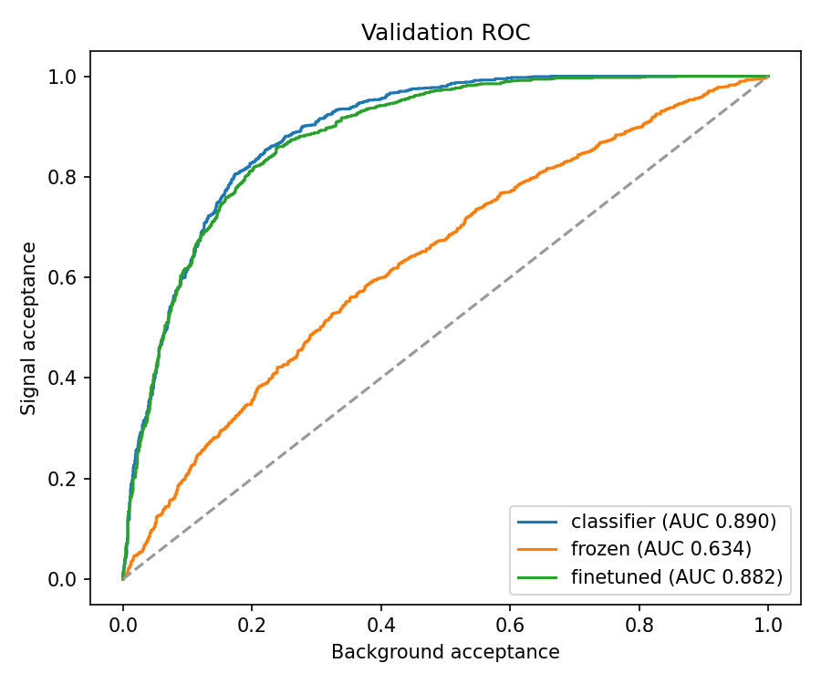
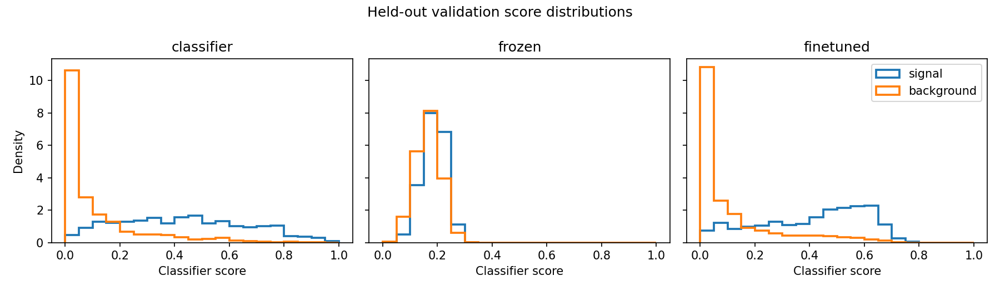
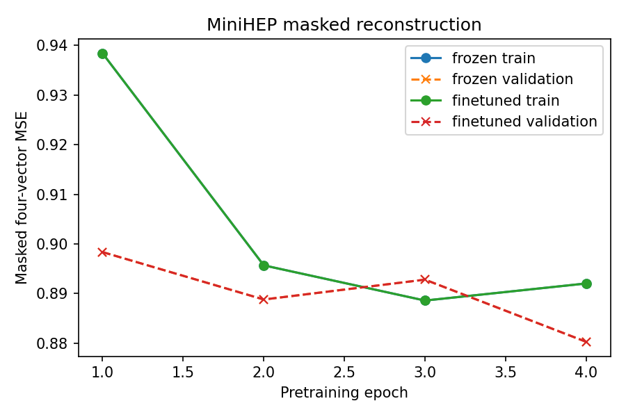
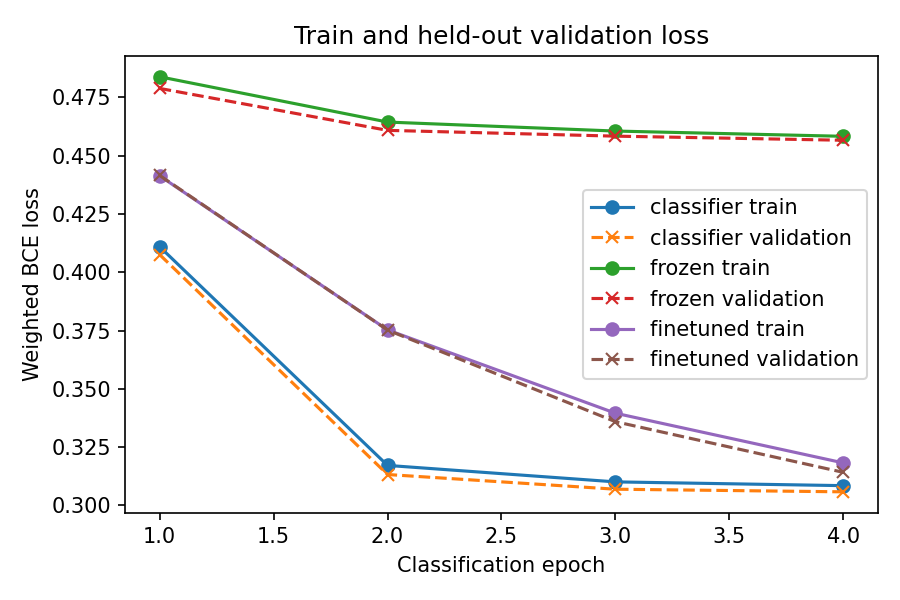

# Model and fit comparison

This comparison uses the same synthetic event pool, four training epochs, held-out template partition, 24-case mixed-μ suite, and common fit settings for each path. It is a compact teaching demonstration, not an acceptance threshold or an experimental result.

!!! warning "Synthetic teaching sample"
    All results below use a synthetic teaching surrogate, not ATLAS data. The suite has only 24 cases, so differences are noisy and should be treated as preliminary. A zero false-discovery fraction in a small null sample is not a bound on rare false discoveries. Use 50 or more cases before making a strong claim.

## Results

Loading the generated model comparison…

The supervised classifier reaches validation AUC 0.8904. With eight score bins, its RMS μ residual is 0.0782, mean reported μ uncertainty is 0.0792, and pull width is 1.027. Keeping the same trained classifier and collapsing its score to one bin leaves AUC unchanged at 0.8904, but RMS residual rises to 0.1265, mean reported uncertainty to 0.474, pull width falls to 0.271, and discovery power is zero in this suite. The fit cannot use ranking information that has been discarded by the one-bin template. This controlled example demonstrates that classification quality alone does not determine measurement quality.

The four-score-bin version also keeps AUC at 0.8904; its RMS residual is 0.0779 and pull width is 1.023. Fine-tuned MiniHEP has AUC 0.8821, RMS residual 0.0798, and pull width 1.009. The frozen probe has lower AUC (0.6338) and a larger RMS residual (0.2927) and mean uncertainty (0.323). These are results from this one 24-case synthetic suite, not universal model comparisons.

The one-bin classifier has a higher AUC than fine-tuned MiniHEP, yet its much larger uncertainty makes a weaker measurement. This comparison deliberately changes the downstream binning to expose the bottleneck; it does not establish that the classifier architecture is worse. Moving the same classifier from one bin to eight restores the fit's use of the score ordering. The separate four-bin experiment shows that finer binning can also cost precision when simulation statistics are limited.

## Diagnostic plots

The four-epoch encoder is a small foundation-model teaching prototype. Its reconstruction and classification losses are diagnostics, not evidence by themselves of downstream measurement quality. A zero false-discovery fraction in this suite is not a precise rare-event limit.

## Reproducibility details

The machine-readable record is [`model-ablation-v1`](assets/ablation.json). It includes the generated sample origin, training-pool hash, seed, epochs, suite size and truth grid, fit settings, and per-model results. Reproduce the comparison from source and review the [encoder path](encoder.md) before drawing a conclusion.

